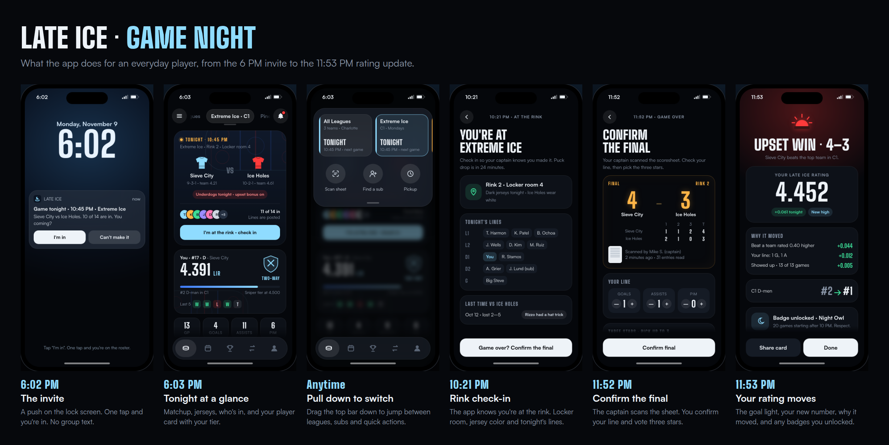

# Late Ice

**Every game counts. Even the 11:15.**

Late Ice is a national rating and competition layer for adult rec ("beer league") hockey. Every game at every rink feeds one portable player rating, the **LIR (Late Ice Rating)**. That rating powers standings across rinks, leagues and cities, plus badges, sub matching and fairer divisions.



## Game night, start to finish

| Time | Step | What happens |
| --- | --- | --- |
| 6:02 PM | The invite | A push notification. RSVP from the lock screen in one tap. |
| 6:03 PM | Tonight at a glance | Matchup, jersey colors, who's in, and your player card with your tier. |
| Anytime | Pull down to switch | Drag the top bar down to expand the active league into a switcher with quick actions (scan sheet, find a sub, pickup). |
| 10:21 PM | Rink check-in | Location-aware check-in, locker room, jersey color and tonight's lines. |
| 11:52 PM | Confirm the final | The captain scans the scoresheet. Players confirm their line and vote three stars. |
| 11:53 PM | Your rating moves | The goal light goes on, your new LIR shows up with a breakdown of why it moved, and badges and standings update. |

## Stack

- **App:** Next.js (App Router, TypeScript, Tailwind) in `app/`, installable as a PWA. Pages and the API live in one deploy.
- **Data:** Supabase Postgres. Row level security is on for every table with no policies, so the browser key can read nothing; all data goes through the server, and real names of unclaimed players never leave it.
- **Sign-in:** a 6-digit code emailed by Supabase Auth (sent through Resend). No passwords, no links.
- **Scoresheets:** photos in a private Supabase Storage bucket; a Claude vision model reads them after the upload returns.
- **Ratings:** `app/src/server/rating.ts`. Each confirmed game is rated once; a nightly job (Vercel Cron, `/api/cron/recompute`) replays every game from starting ratings so ratings can't drift.

## Run it locally

```bash
cd app
npm ci
npx supabase start          # local Postgres, Auth and Storage (needs Docker)
npx supabase status -o env  # copy API_URL, ANON_KEY, SERVICE_ROLE_KEY, DB_URL into .env.local (see .env.example)
npm run dev                 # http://localhost:3000
```

Locally, sign-in emails are caught by Mailpit at http://127.0.0.1:54324 instead of being sent; open it to read your code.

## Deploy (Supabase + Vercel)

1. **Supabase:** create a project. From Project Settings > API copy the URL, anon key and service role key. From Connect, copy the **Transaction pooler** URI (port 6543) for the app and the **Session pooler** URI (port 5432) for migrations.
2. **Schema:** add a GitHub repository secret `SUPABASE_DB_URL` with the Session pooler URI. The `Database migrations` workflow applies `app/supabase/migrations`.
3. **Email sign-in:** Authentication > Sign In / Providers: Email on (6-digit codes, 10-minute expiry), Phone off. Email Templates: Magic Link and Confirm signup show `{{ .Token }}` (copy `app/supabase/templates/magic_link.html`). SMTP: Resend (`smtp.resend.com`, port 465, user `resend`, the Resend API key as password) with a sender on a verified domain. Raise the hourly email rate limit to fit sign-ups.
4. **Vercel:** import the repo with root directory `app` and add the variables from `app/.env.example` (`DATABASE_URL` is the Transaction pooler URI). `vercel.json` schedules the nightly rating replay.

## The app (Wilmington pilot)

The C league is loaded with the real Fall 2026 teams, standings and one team's player totals as posted on the rink's league site, so the app is useful before the first sheet is scanned. Seasons are per rink; a sheet's date drops the game into the right season, standings reset per season and ratings carry over. Test scoresheets live in a separate Demo league so they never touch real standings.

- `app/src/server/ocr.ts` reads scoresheets and cross-checks them. `app/src/server/services.ts` has team matching and game confirmation. `app/src/server/accounts.ts` has sign-in, the draft pool, captain tools and name privacy.
- `app/samples/` has synthetic test scoresheets (`make_sheets.py`) with their ground truth (`truth.json`).
- CI (`.github/workflows/ci.yml`) boots a local Supabase stack, builds, runs `app/script/smoke.ts` (API end to end) and `app/script/ui-shots.mjs` (phone-sized browser walkthrough).

## What's here

| Path | What it is |
| --- | --- |
| `app/` | The app: Next.js pages and API, Supabase migrations, scripts |
| `mockup/index.html` | Interactive mockup of the game-night flow. It's a single file: open it in any browser. |
| `docs/game-night-flow.png` | Storyboard of the six steps |
| `docs/ADOPTION-BASICS.md` | The basics the app must answer before people adopt it: onboarding, rosters, rinks, trust, privacy |
| `docs/MVP-PLAN.md` | MVP plan: market context, competitors, rating design, phased features, go-to-market, business model, tech stack |
| `branding/BRANDING.md` | 10 brand directions with logo marks |
| `branding/logos/` | SVG logo marks |
