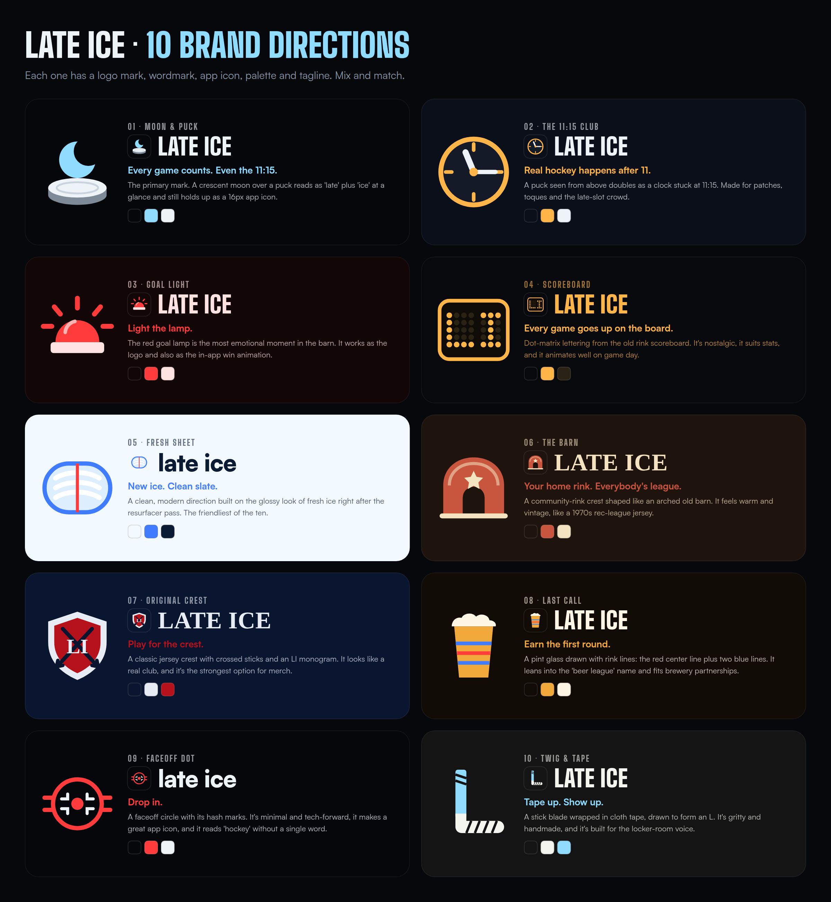
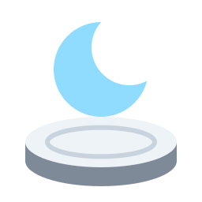
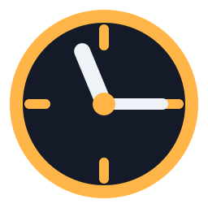
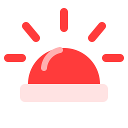
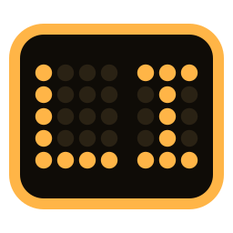
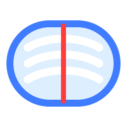
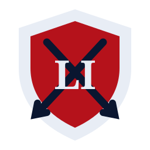
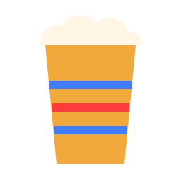
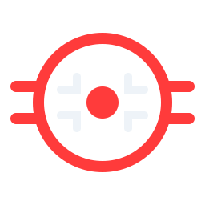
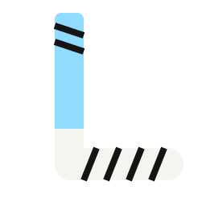

# Late Ice — Brand Directions

Ten directions, each with its own logo mark, wordmark style, palette and tagline. They can be mixed: for example, Moon & Puck as the primary mark, Goal Light as the win moment, and The 11:15 Club for merch.

## 1. Moon & Puck

**Tagline:** Every game counts. Even the 11:15.

The primary mark. A crescent moon over a puck reads as 'late' plus 'ice' at a glance and still holds up as a 16px app icon.

**Palette:** `#05070B` · `#8FDCFF` · `#EEF3F8`  
**Wordmark:** Big Shoulders Display, all caps

## 2. The 11:15 Club

**Tagline:** Real hockey happens after 11.

A puck seen from above doubles as a clock stuck at 11:15. Made for patches, toques and the late-slot crowd.

**Palette:** `#0B0F1A` · `#FFB547` · `#EEF3F8`  
**Wordmark:** Big Shoulders Display, all caps

## 3. Goal Light

**Tagline:** Light the lamp.

The red goal lamp is the most emotional moment in the barn. It works as the logo and also as the in-app win animation.

**Palette:** `#120607` · `#FF3B3B` · `#FFE3E3`  
**Wordmark:** Big Shoulders Display, all caps

## 4. Scoreboard

**Tagline:** Every game goes up on the board.

Dot-matrix lettering from the old rink scoreboard. It's nostalgic, it suits stats, and it animates well on game day.

**Palette:** `#07090D` · `#FFB547` · `#2A2214`  
**Wordmark:** Big Shoulders Display, all caps

## 5. Fresh Sheet

**Tagline:** New ice. Clean slate.

A clean, modern direction built on the glossy look of fresh ice right after the resurfacer pass. The friendliest of the ten.

**Palette:** `#F3FAFF` · `#3F7CFF` · `#0B1B33`  
**Wordmark:** Satoshi, lowercase

## 6. The Barn

**Tagline:** Your home rink. Everybody's league.

A community-rink crest shaped like an arched old barn. It feels warm and vintage, like a 1970s rec-league jersey.

**Palette:** `#1E140D` · `#C8553D` · `#F4E3C1`  
**Wordmark:** Georgia, all caps

## 7. Original Crest

**Tagline:** Play for the crest.

A classic jersey crest with crossed sticks and an LI monogram. It looks like a real club, and it's the strongest option for merch.

**Palette:** `#0A1630` · `#E8EDF5` · `#B5121B`  
**Wordmark:** Georgia, all caps

## 8. Last Call

**Tagline:** Earn the first round.

A pint glass drawn with rink lines: the red center line plus two blue lines. It leans into the 'beer league' name and fits brewery partnerships.

**Palette:** `#100B05` · `#F2A93B` · `#FFF6E5`  
**Wordmark:** Big Shoulders Display, all caps

## 9. Faceoff Dot

**Tagline:** Drop in.

A faceoff circle with its hash marks. It's minimal and tech-forward, it makes a great app icon, and it reads 'hockey' without a single word.

**Palette:** `#05070B` · `#FF3B3B` · `#EEF3F8`  
**Wordmark:** Satoshi, lowercase

## 10. Twig & Tape

**Tagline:** Tape up. Show up.

A stick blade wrapped in cloth tape, drawn to form an L. It's gritty and handmade, and it's built for the locker-room voice.

**Palette:** `#141414` · `#F5F5F0` · `#8FDCFF`  
**Wordmark:** Big Shoulders Display, all caps

## Files

- `logos/*.svg`: vector logo marks (64×64 viewBox)
- `concepts.json`: concept data (names, palettes, taglines, SVG markup)
- `gen.py`: regenerates the SVGs and `concepts.json`
- `board.html`: the brand board source; `brand-board.png` is the rendered version
